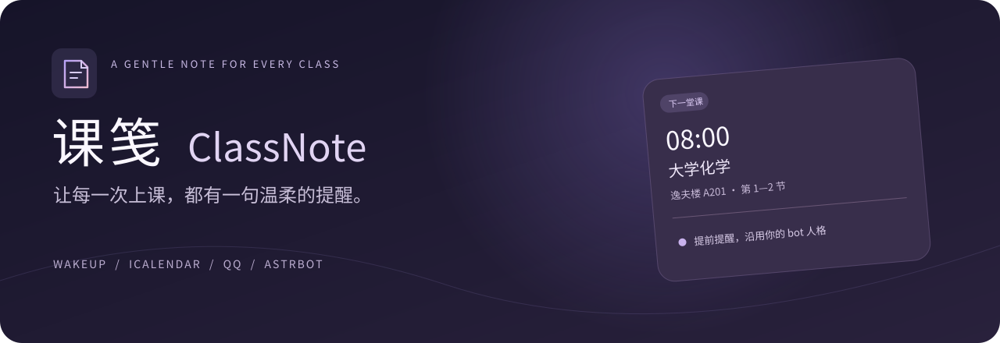
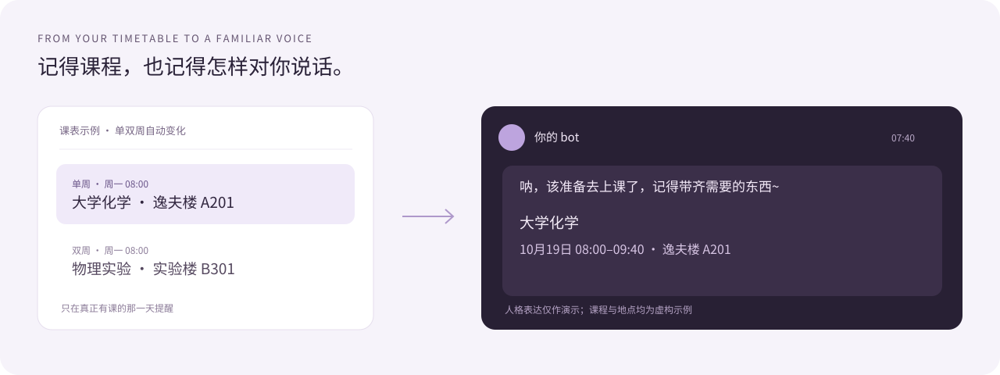

<p align="center"></p>

<p align="center">
  
  =4.20" />
  
  
  
</p>

<p align="center"><b>把课程记在笺上，把提醒留给熟悉的声音。</b><br />可视化课表 · AstrBot 未来任务 · WakeUp 导入 · 当前会话人格</p>

<p align="center"><a href="#快速开始">快速开始</a> · <a href="#导入你的课表">导入课表</a> · <a href="#常用指令">指令一览</a> · <a href="docs/INSTALL.md">安装与升级</a> · <a href="DESIGN.md">开发设计</a></p>

---

课笺是一个 AstrBot 课程表提醒插件。你可以把 WakeUp 导出的 `.ics` 日历文件直接发给 bot，也可以导入兼容的分享口令。它按照每一次真实上课安排计算提醒，并读取当前 QQ 会话的人格和模型，让 bot 用熟悉的语气喊你去上课。

<p align="center"></p>

## 这张课笺能记住什么

| 能力 | 你会得到的体验 |
| --- | --- |
| 可视化管理 | 在 AstrBot 插件视图中查看一周课表，预览导入、停调课、修改提醒和查看投递记录 |
| AstrBot 未来任务 | 为未来 7 天每次提醒建立一次性任务，自动续排，可在原生任务页中查看与暂停 |
| WakeUp 日历文件 | 直接发送 `.ics` 或 `.ical` 文件即可导入，不依赖分享口令继续有效 |
| 每周不同的课程 | 支持重复规则、单双周、非连续日期和例外日期，按实际课次提醒 |
| 日历中的调课 | 识别 `EXDATE`、`RDATE`、`RECURRENCE-ID` 与取消状态 |
| bot 自己的语气 | 每次提醒读取当前会话人格与模型，课程、时间、地点由程序保留 |
| 你的提前量 | 可沿用日历自带提醒，也可设置提前 30、10 分钟分别提醒 |
| 运行恢复 | SQLite 保存课表及投递记录，支持去重、有限重试和短时补发 |

## 快速开始

**环境：AstrBot >=4.20、<5；Python >=3.11，并满足所用 AstrBot 自身的 Python 要求；已接入能够主动发送消息的 QQ 适配器。**

0.3.1 修复 0.3.0 过高的版本限制和页面接口导致的加载失败。管理页需要新版插件视图与 Web API（已验证 4.28.2、4.29.3）；4.20.0 可使用 QQ 指令和原生未来任务，缺少新版页面接口时会跳过管理页。

1. 在 AstrBot 插件管理中从 `https://github.com/azaleakita/astrbot_plugin_classnote` 安装，或将仓库文件放进 `data/plugins/astrbot_plugin_classnote/`。
2. 重载插件，确认自己的 QQ 账号已加入 AstrBot 管理员。默认只开放管理员私聊使用。
3. 打开 **插件 → 课笺 → 课表管理**，点击“导入课表”，选择已有 QQ 会话，上传 WakeUp 导出的 `.ics`，先预览再确认。也可以直接将 `.ics` **作为文件附件**发送给 bot。

然后用下面两条指令核对：

```text
/课表 下次
/课表 测试
```

“下次”展示接下来的计划提醒；“测试”使用正式提醒的主动投递和人格接口，不消耗正式提醒记录。

## 可视化课表管理

自 `v0.3.0` 起随插件提供官方 `views/classnote/` 视图，无需额外启动网页服务或构建前端。重载插件后，在插件详情中打开“课表管理”；支持侧边栏视图入口、桌面与窄屏布局，以及跟随 AstrBot 的浅色 / 深色主题。

| 页面 | 可以做什么 |
| --- | --- |
| 课表总览 | 切换不同持有者的课表，翻周查看课程，暂停、开启、测试、设置提前量、停课调课、导出 ICS |
| 提醒计划 | 查看原生一次性任务、提醒时间和状态，暂停单次提醒，手动同步、恢复已删除任务 |
| 投递记录 | 查看当前课表最近 50 次正式投递的状态、尝试次数和错误类型 |
| 插件设置 | 切换调度模式，设置默认时区、提前量、补发窗口、人格开头及使用范围 |

导入支持日历文件、分享文本和 WakeUp 备份；确认前会显示课次、范围、投递地与解析提示。页面通过 AstrBot 的 bridge 和认证接口通信，不存储 Dashboard 密码或令牌。管理员在页面中可以管理全部课表；QQ 指令仍按会话、发送者和插件权限隔离。

详细操作与排查见 [可视化管理与未来任务](docs/WEBUI.md)。

## 设置与任务需求实时同步 · v0.4.0

在管理页“插件设置 → 熟悉的语气”编辑 **未来任务需求模板**，保存后自动同步已经排入的任务。修改默认提前量会重新安排未设置个人提前量的课表；时区更新同步已有课表，日历的绝对上课时刻保持不变。使用 AstrBot 自带插件配置入口时，保存并按该入口提示重载；课笺后台也会定期核对。

模板支持 `{nickname}`、`{course}`、`{date}`、`{start}`、`{end}`、`{room}`、`{lead}`、`{timezone}`，最多 2000 字。例如：

```text
请沿用当前会话的人格，温柔提醒 {nickname} 准备出发，并提醒带上水杯。
课程：{course}；{date} {start}–{end}；地点：{room}；提前 {lead} 分钟。
```

在“提醒计划”展开 **任务需求** 即可预览；点击 **编辑需求** 为这一条提醒填写独立文本（最多 4000 字），或勾选“恢复跟随全局模板”。AstrBot 原生“未来任务”里编辑任务需求也会被保留为单条自定义，后续全局模板变更不会覆盖它。

需求会实际传入当前人格的生成提示，课程名、时间和地点仍由程序准确追加；关闭人格生成时使用备用开头。仅修改需求不更换任务 ID，保留暂停与删除状态。修改提前量会替换对应排期，不重发已成功的同一次提醒。

提前量优先级：**个人自定义 → 日历闹钟 → 全局默认**。如需让曾经单独设置过的课表重新跟随全局，可在“课表总览 → 提醒设置”选择“跟随插件默认设置”，或发送 `/课表 提前 默认`。此选项可明确覆盖日历闹钟；`/课表 提前 日历` 恢复日历优先。

## 使用 AstrBot「未来任务」提醒

默认 `scheduler_mode=future_tasks`，每次课程提前提醒都对应一个**带真实日期的一次性任务**，任务名以“课笺 ·”开头。采用 AstrBot `CronJobManager` 的基础回调任务，按时调用插件的统一投递流程；人格、精确课程信息、重试和去重仍由课笺处理，不需要让 Agent 猜测课表或调用工具创建任务。

- 滚动安排未来 7 天，后台每 30 秒检查续排；导入、停调课、暂停、修改提前量后立即同步。
- 同一门课设置 30、10 分钟提醒时，会生成两项独立的一次性任务。单双周、非连续日期和例外仍按实际课次展开。
- 可在课笺“提醒计划”或 AstrBot 原生“未来任务”中暂停单项任务；手动删除的任务不会被自动建回来，需要时点击“恢复已删除的任务”。
- 原生任务的时间请勿单独编辑，改课请使用课笺设置，避免和课程事实不一致。
- 插件重载时只清理并重新绑定自己管理的任务，保留单项暂停状态；不修改其他插件或手动创建的任务。
- 未来任务接口缺失时自动使用轮询；接口恢复后自动接入原生任务，页面显示实际使用的模式。
- 可切换 `scheduler_mode=polling` 使用原有每 10 秒轮询；两种模式共享 SQLite 投递记录，切换不会重发已成功的提醒。
- 未来任务回调最多并行 4 条；每张课表预排最多 200 项，全部课表合计最多 1000 项。触及上限时页面提示，剩余任务随时间推进续排。

AstrBot 必须在线。一次性任务执行失败后由 AstrBot 移除，课笺会在补发窗口内通过新任务进行有限重试；同一提醒最多尝试 3 次。全局关闭、单课表暂停和群聊权限均在执行前重新核对。

## 导入你的课表

### 推荐：WakeUp 日历文件

WakeUp 主界面右上角的导出入口 → **导出为日历文件** → 将 `.ics` 文件发送给 bot。

默认开启直接附件导入。若关闭了 `auto_import_ics`，则先发送 `/课表 导入日历`，再在 **2 分钟内**发送文件。也支持在带附件的消息中使用这条指令，或引用能够提供文件消息段的消息执行导入。待导入状态不会跨会话共享。

日历中的每次课程保留实际日期和起止时间。有限 `RRULE`、`RDATE`、`EXDATE`、单次改期和取消会在导入时展开；UTF-8 中文、折行、地点、UTC 与 `TZID` 时区由日历解析库处理。

WakeUp Android/鸿蒙版导出日历默认带提前 20 分钟提醒。新订阅优先读取日历里的相对开始时间提醒；没有可用提醒时使用插件默认值。手动设置的提前量优先级更高：

```text
/课表 提前 30,10
/课表 提前 日历
```

第一条覆盖为提前 30 和 10 分钟，第二条恢复日历设置。绝对时间闹钟、相对结束时间闹钟不会转换为上课提醒。

> 日历导入是一次快照。WakeUp 中之后新增或修改课程，需要重新导出再发送；插件不会自行读取你的教务账号。

### 兼容：分享文本与备份文本

```text
/课表 导入 完整的WakeUp分享文本或口令
/课表 导入文本 原始WakeUp备份文本或兼容JSON
```

分享导入适配经典 `share_schedule/get` 协议，不保证新版鉴权或加密分享兼容。遇到协议错误时，可改用日历文件。备份文本保留教学周、单双周、非连续周次与节次作息。

所有导入都会先完整校验再替换课表。解析失败时，原课表和提醒设置仍保留。

## 常用指令

| 指令 | 作用 |
| --- | --- |
| `/课表 导入日历` | 等待或读取 WakeUp `.ics` 附件 |
| `/课表 今日`、`/课表 明日`、`/课表 本周` | 查询实际课程 |
| `/课表 下次` | 查看接下来的 5 次计划提醒 |
| `/课表 状态` | 查看日期范围、提醒设置及投递状态 |
| `/课表 提前 20` | 使用自己的提前时间，单位为分钟 |
| `/课表 提前 30,10` | 最多设置 3 次提前提醒 |
| `/课表 提前 日历` | 恢复使用 ICS 自带的相对提醒 |
| `/课表 停课 2026-10-21` | 停止当天全部课程提醒 |
| `/课表 调课 2026-10-24 2026-10-19` | 24 日改上 19 日的课程，替换目标日安排 |
| `/课表 恢复 2026-10-24` | 移除当天的停课或调课覆盖 |
| `/课表 开学 2026-09-07` | 校准分享/备份课表的第一教学周周一 |
| `/课表 暂停`、`/课表 开启` | 保留课表，暂停或恢复提醒 |
| `/课表 测试` | 主动投递下一门课程的测试提醒 |
| `/课表 删除` | 删除你在当前会话的课表及投递记录 |

**调课不自动取消原日期。** 若周六补周一课、周一放假，分别设置“调课”和“停课”。重新导入会保留提前量、暂停状态及手动日期覆盖；新学期想完全重置时，先删除再导入。

日历按真实日期排课，不通过“开学”指令整体平移。该指令只用于包含教学周规则的分享/备份课表。

## 提醒，仍然是你的 bot

课笺每次提醒都读取**目标会话**生效的人格与模型。可用时复用 AstrBot 主 Agent 的统一人格解析器，兼容会话规则强制人格、对话人格及默认人格选择。

人格提示及少量人格预设对话用于生成简短开头；准确的课程名、日期、起止时间和地点由程序追加。修改主人格后，后续提醒随之使用新设定。

模型异常或超时时，使用 `fallback_opener` 继续发送详情；建议把备用开头也设成 bot 的风格。每个待投递提醒通常调用一次模型，重试可能再次调用。关闭 `use_llm_persona` 可使用固定开头。日常聊天历史不会发送给模型，因此其他插件追加的记忆或动态提示不一定被继承。

## QQ、权限与数据

- OneBot v11 / NapCat，以及具备主动消息能力的 QQ 官方适配器，可通过 AstrBot 接口投递；文件接收与主动权限应在自己的环境中验证。
- 默认管理员私聊可用。开放 `allow_group` 后，在群内导入即订阅该群提醒，投递时只 @ 导入者。
- 每个“会话 + 用户”单独保存课表。私聊课表不会自动发到群；在多处订阅可能分别收到提醒。
- 数据保存在 `data/plugin_data/astrbot_plugin_classnote/timetables.sqlite3`。仓库只包含虚构课表示例。
- AstrBot 和 QQ 适配器需要持续在线。默认只补发 5 分钟窗口内、课程尚未开始的提醒；失败最多尝试 3 次。
- 轮询和模型调用存在延迟；极端崩溃窗口可能重复，不承诺 QQ 端严格恰好一次或已读。

## 从旧版升级

旧插件名为 `astrbot_plugin_wakeup_reminder`。**先停用旧插件，再安装课笺**，避免两份插件同时提醒。

首次启动时，若新数据库不存在，会通过 SQLite 备份接口复制旧数据；旧文件保留不动，订阅、提前量和投递记录随之迁移。旧版配置需在新插件设置中核对，群聊默认仍关闭。详见 [安装与升级](docs/INSTALL.md)。

## 兼容范围与测试

文件上限 2 MiB，原始事件最多 2000 条，展开最多 10000 课次，整体跨度最多 550 天。只接收带精确起止时间的有限课程；全天事件、无限重复、小时/分钟级重复、无效时间和未知时区会明确拒绝。主要面向 `Asia/Shanghai`，夏令时切换未专项验证。

当前 **88 项 Python 离线测试与 18 项页面交互测试通过**。新增真实 AstrBot **4.20.0、4.28.2、4.29.3** 集成测试：完整插件加载器、真实 SQLite、原生一次性任务创建、提醒回调去重与卸载清理均已通过；CI 持续执行同一矩阵。集成测试仅替换外部 QQ 发信，未在用户真实 QQ 实例和完整 AstrBot WebUI 中完成部署联调。页面交互测试使用 jsdom。

```bash
# 在插件目录的父目录运行
python -m pip install -r astrbot_plugin_classnote/requirements.txt
python -m unittest discover -s astrbot_plugin_classnote/tests -v

# 可选：仅开发页面测试需要 Node.js，插件运行不需要
cd astrbot_plugin_classnote
npm ci --ignore-scripts
npm run test:ui
```

附有 [虚构日历样例](examples/wakeup-demo.ics)、[变更记录](CHANGELOG.md)、[设计说明](DESIGN.md) 和自动测试工作流。

## 致谢与许可

基于 [AstrBot 官方插件文档](https://docs.astrbot.app/dev/star/plugin-new.html)；日历能力使用 [icalendar](https://icalendar.readthedocs.io/) 和 [recurring-ical-events](https://recurring-ical-events.readthedocs.io/)。WakeUp 导出方式参见 [官方使用文档](https://www.wakeup.fun/doc/export_schedule.html)。

经典分享字段与五段备份协议参考 [koishi-plugin-course-schedule](https://github.com/VincentZyuApps/koishi-plugin-course-schedule) 作者公开维护的实现说明。本插件独立编写，未复制其源代码。

[MIT License](LICENSE) · CREAM / azaleakita
